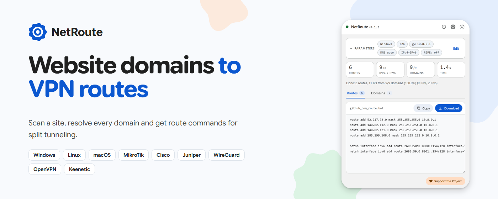
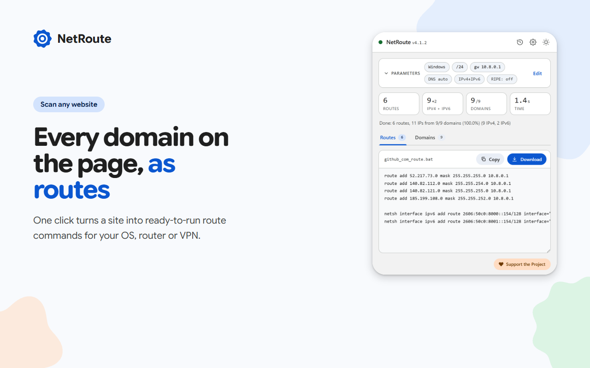
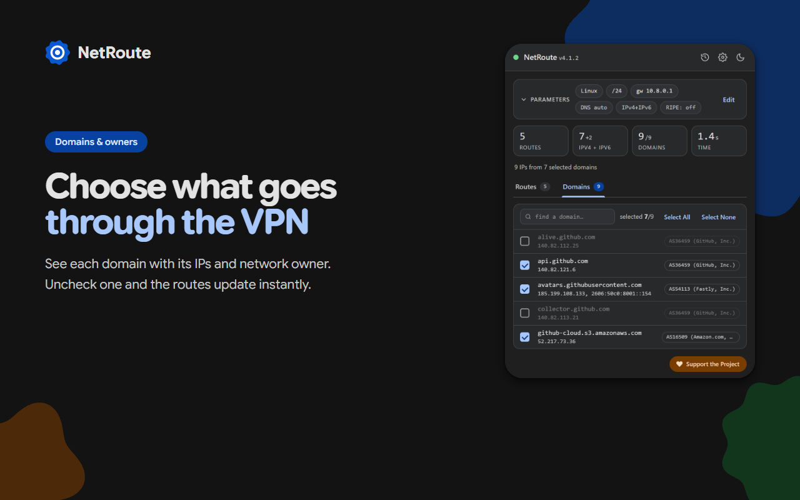
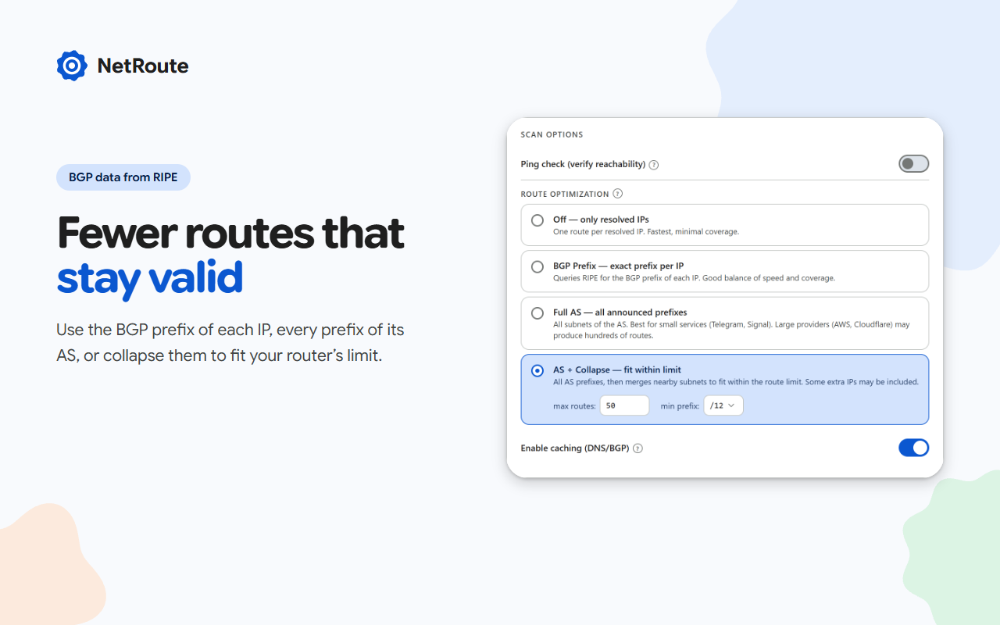
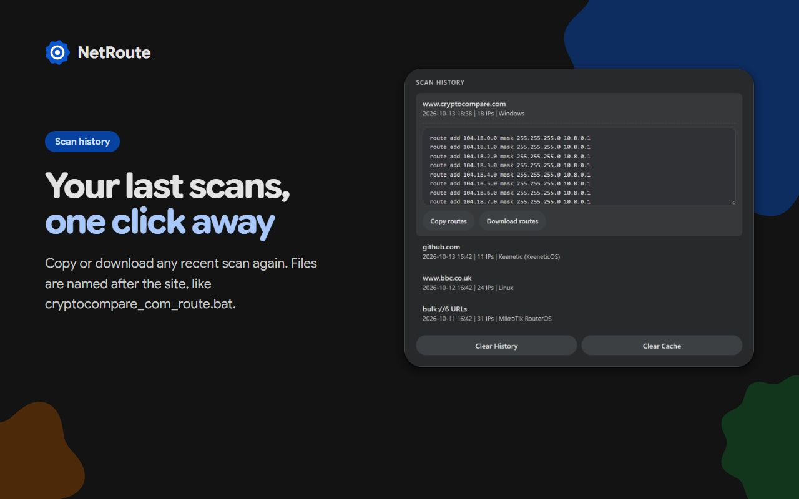
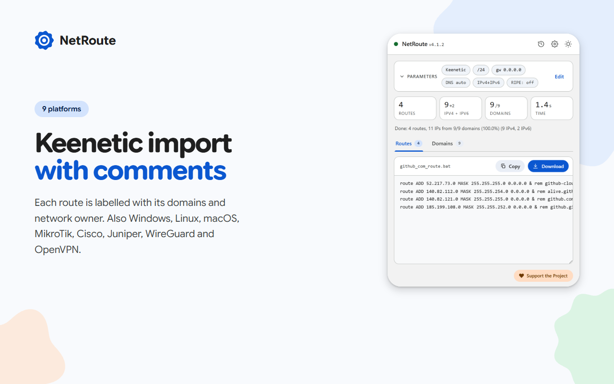

# NetRoute

**Smart Route Generation for Network Engineers**

Chrome extension that discovers domains on any webpage, resolves IPs via racing DNS queries, and generates optimized routing commands for 9 platforms.

**🌐 Live site:** [alexander2k.github.io/netroute-site](https://alexander2k.github.io/netroute-site/)
**🧩 Chrome Web Store:** [NetRoute](https://chromewebstore.google.com/detail/netroute-domain-to-ip-map/binkmcoafjdoalbbbakpaojbknjmdmla)

## Features

- **Network Sniffer** — captures dynamic background requests (AJAX, CDN, API) in real-time via Service Worker
- **DNS Racing** — queries Cloudflare, Google, Quad9, AdGuard simultaneously via `Promise.any` — first response wins; custom DoH servers can be added
- **Works when DoH is blocked** — falls back to the IPs the browser itself connected to and resolves the rest through the system resolver
- **CIDR Aggregation** — merges individual IPs into optimized subnets (IPv4 bitmask + IPv6 BigInt)
- **Route Optimization (RIPE BGP)** — BGP prefix per IP, every prefix the AS announces, or AS prefixes collapsed to fit a route limit
- **ASN Lookup** — batch IP-to-ASN resolution (e.g. `AS13335 (Cloudflare)`)
- **Bulk Scan** — paste a list of URLs, generate aggregated routes for all hostnames at once
- **Domain Blacklist** — exclude analytics/trackers, syncs across devices via Chrome Cloud Sync
- **File Export** — download as `.bat`, `.sh`, `.rsc`, `.conf`, `.ovpn` and more with headers and verification commands; files are named after the site (`example_com_route.bat`)
- **Keenetic Export** — `.bat` import format with every route commented with its domains and ASN
- **Scan History** — the last 10 scans, ready to copy or download again
- **Custom Templates** — your own route syntax with `{{network}}`, `{{cidr}}`, `{{gateway}}` and other macros

## Supported Platforms

| Platform | IPv4 | IPv6 |
|----------|------|------|
| **Windows** | `route add {net} mask {mask} {gw}` | `netsh interface ipv6 add route` |
| **Linux** | `ip route add {net}/{cidr} via {gw}` | `ip -6 route add` |
| **macOS** | `route add -net {net}/{cidr} {gw}` | `route add -inet6` |
| **MikroTik** | `/ip route add dst-address=` | `/ipv6 route add` |
| **Cisco** | `ip route {net} {mask} {gw}` | `ipv6 route` |
| **Juniper** | `set routing-options static route` | `set rib inet6.0 static route` |
| **WireGuard** | `AllowedIPs = {net}/{cidr}` | `AllowedIPs = {addr}` |
| **OpenVPN** | `route {net} {mask}` | `route-ipv6` |
| **Keenetic** | `route ADD {net} MASK {mask} {gw}` | IPv4 only |

## Screenshots

### Routes from any website

### Domains, IPs and network owners

### Route optimization with BGP data

### Scan history with file download

### Keenetic import with comments

## How It Works

1. **Install & Navigate** — add the extension from Chrome Web Store, navigate to any site
2. **Configure & Scan** — choose target OS, merge mask, gateway, domain filter, click Analyze Website
3. **Copy or Export** — grab generated routes, copy to clipboard or export as script file

## Step-by-Step Guides

Detailed instructions for applying generated routes on each platform:

- [Keenetic](https://alexander2k.github.io/netroute-site/guides/keenetic.html) — `.bat` file upload with VPN interface binding
- [MikroTik](https://alexander2k.github.io/netroute-site/guides/mikrotik.html) — `.rsc` script import via `/import`
- [WireGuard](https://alexander2k.github.io/netroute-site/guides/wireguard.html) — AllowedIPs on any client (Linux/Windows/macOS/mobile)
- [Linux](https://alexander2k.github.io/netroute-site/guides/linux.html) — `.sh` script with systemd-networkd / NetworkManager persistence
- [OpenVPN](https://alexander2k.github.io/netroute-site/guides/openvpn.html) — client config `route` directives for split tunneling

Rule formats for proxy and VPN clients (NetRoute 4.1.3):

- [sing-box](https://alexander2k.github.io/netroute-site/guides/singbox.html) — rule-set for sing-box and Hiddify (`route.rule_set`, `.srs`)
- [Happ](https://alexander2k.github.io/netroute-site/guides/happ.html) — routing profile added as a `happ://routing/onadd` link
- [Xray](https://alexander2k.github.io/netroute-site/guides/xray.html) — `routing.rules` for Xray-core, the 3X-UI panel and rule import in v2rayN
- [AmneziaVPN](https://alexander2k.github.io/netroute-site/guides/amnezia.html) — site list for split tunneling by addresses

Each guide links to official vendor documentation and covers common pitfalls. The guide pages for the rule formats are generated from `tools/guide_content/` by `tools/gen_client_guides.py`; every guide embeds a render of the real extension popup (`screenshots/guides/`, produced by `scripts/render_guide_shots.cjs` in the extension repository).

## Available Languages

The site is available in **4 languages**:
- 🇬🇧 [English](https://alexander2k.github.io/netroute-site/)
- 🇷🇺 [Русский](https://alexander2k.github.io/netroute-site/ru/)
- 🇪🇸 [Español](https://alexander2k.github.io/netroute-site/es/)
- 🇨🇳 [中文](https://alexander2k.github.io/netroute-site/zh/)

## Tech Stack

- Chrome Extension (Manifest V3)
- Service Worker for network sniffing
- DoH (DNS over HTTPS) with racing resolution
- RIPE Stat API for BGP prefix lookups
- 5 interface languages

## Support the Project

## License

All rights reserved.
